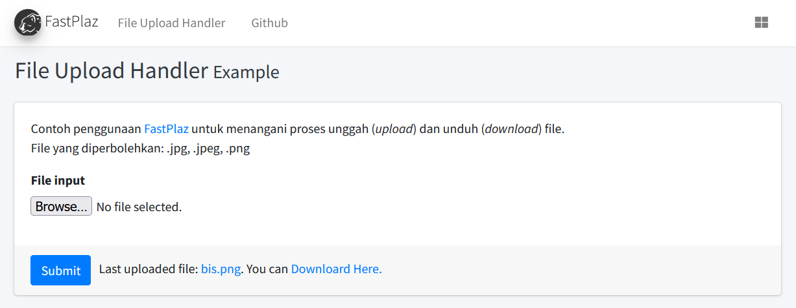

# File Upload Handler dengan FastPlaz


Repositori ini berisi contoh sederhana penggunaan [FastPlaz](https://fastplaz.com) sebagai handler terhadap proses upload file di web. Ditambah juga contoh handling jika suatu saat diperlukan proses *force download* suatu file.

Contoh *live* ada di [https://examples.fastplaz.com/file-upload/](https://examples.fastplaz.com/file-upload/)

Buat yang kesulitan untuk kompilasi, sudah disediakan file *executable* untuk linux yang bisa diunduh dari halaman [Release](https://github.com/luridarmawan/fastplaz-example-fileupload/releases)


## Kompilasi

Membutuhkan FastPlaz versi 2026 "Hero" atau yang lebih baru.

```sh
cd source/web
./build.sh filehandler
# atau: lazbuild filehandler.lpi
```

Hasilnya `public_html/filehandler.bin`.

## Menjalankan

Satu binary bisa jalan dalam dua mode, tanpa mengubah kode.

**Standalone (HTTP server sendiri)**

```sh
public_html/filehandler.bin
# opsi: --port=17845 --address=127.0.0.1 --static=on|off
```

Buka http://127.0.0.1:17845. Panduan deploy di belakang nginx/Apache ada di
[STANDALONE-deployment.md](https://github.com/luridarmawan/fastplaz/blob/master/docs/STANDALONE-deployment.md).

**CGI (Apache)**

Arahkan document root ke `public_html`. Rule di `.htaccess` sudah meneruskan request ke `filehandler.bin`, dan mode CGI terpilih otomatis karena web server mengisi `GATEWAY_INTERFACE`.

## Catatan keamanan

- Nama file dari browser tidak dipakai mentah. Path dibuang, karakter selain `A-Z a-z 0-9 . _ -` diganti `_`, dan file yang sudah ada tidak ditimpa.
- Hanya `.jpg`, `.jpeg`, `.png`, `.pdf` yang diterima (tidak peka huruf besar/kecil).
- `/download/<nama>` hanya melayani file di folder `uploads/`, jadi `../` ditolak.
- Form upload dilindungi CSRF (`[csrf-token name="frmUpload"]` + `isValidCSRF`).
- Nilai yang ditampilkan di template di-escape (`[$FileUpload|escape]`).
- Untuk produksi, set `development` dan `debug` ke `false` di `public_html/config/config.json`.

## Tautan

- [FastPlaz - Pascal Web Framework](https://fastplaz.com) 
- [Pascal Indonesia Web Forum](https://pascal-id.org)


